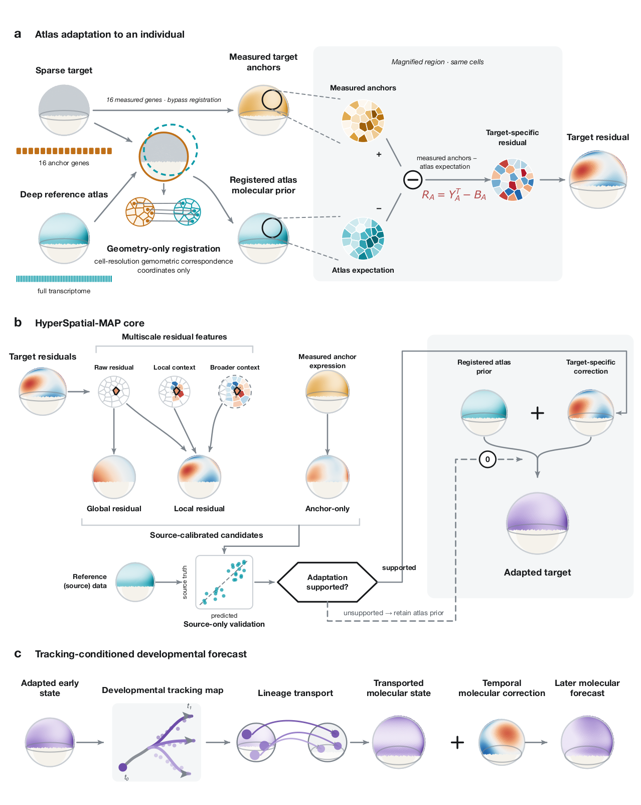

# AtlasTailor

**Sparse measurements tailor a deeply measured spatial atlas to an individual specimen.**

[](https://github.com/sumeer1/AtlasTailor/actions/workflows/ci.yml)
[](LICENSE)
[](pyproject.toml)

AtlasTailor reconstructs an individual target’s spatial molecular state by combining a deeply measured reference atlas with target geometry and a small, prespecified panel of target genes:

```text
registered atlas prior + sparse target adaptation = individualized molecular reconstruction
```


## Framework overview

[](docs/assets/Figure_1.pdf)


## Installation

```bash
git clone https://github.com/sumeer1/AtlasTailor.git
cd AtlasTailor
conda env create -f environment.yml
conda activate atlas-tailor
python -m pip install -e .
```

Python 3.10–3.11 is supported. The primary command-line executable is `atlastailor`. The Python import namespace and legacy `hyperspatial` command remain available for compatibility with the frozen analyses.

## Minimal Python workflow

AtlasTailor separates prediction-time target input from held-out evaluation truth. The target loader below materializes only the 16 measured genes; the full matrix is opened separately only after the prediction run has been completed and hashed.

```python
from hyperspatial import adapt, design_panel, validate
from hyperspatial.io import read_reference, read_target, read_truth

# Deeply measured reference atlas
reference = read_reference("reference.h5ad", coordinate_key="spatial")

# Select the measurement panel using the reference only
panel = design_panel(reference, budget=16, out="runs/panel")

# Load only target geometry and the declared measured genes
target = read_target(
    "target.h5ad",
    measured_genes=panel.genes,
    coordinate_key="spatial",
)

# Geometry-only registration, registered atlas transfer and sparse adaptation
result = adapt(
    reference,
    target,
    measured_genes=panel.genes,
    out="runs/adaptation",
)

# Optional retrospective evaluation, performed only after prediction lock
truth, _ = read_truth("target.h5ad", result.genes, coordinate_key="spatial")
metrics = validate(result, truth, out="runs/adaptation/gene_metrics.tsv")
```

The [documentation](https://atlastailor.readthedocs.io) explains the pipeline, input contract, API and scientific information boundary. 

## Run AtlasTailor on real data

The end-to-end tutorials execute AtlasTailor on public biological datasets. They cover source-only panel design, restricted target loading, geometry-only registration, prediction locking and post-lock evaluation.

| Tutorial | Dataset | Public record | Notebook |
|---|---|---|---|
| 3D reciprocal reconstruction | Zebrafish 50%-epiboly weMERFISH, E1 → E2 | [Dryad](https://doi.org/10.5061/dryad.j0zpc86v9) | [Run the zebrafish tutorial](notebooks/01_run_atlastailor_zebrafish.ipynb) |
| 2D serial-section reconstruction | Human DLPFC Visium, 151507 → 151508 | [spatialLIBD / Figshare](https://doi.org/10.6084/m9.figshare.13623902.v1) | [Run the DLPFC tutorial](notebooks/00_run_atlastailor_dlpfc.ipynb) |
| User dataset template | Prepared reference and target AnnData files | — | [Run AtlasTailor on your data](notebooks/04_run_atlastailor_on_your_data.ipynb) |

The public datasets are not redistributed in this repository. Each tutorial identifies the authoritative record, verifies frozen input hashes where available, and writes new timestamped run directories without altering manuscript results.

## Command-line workflow

AtlasTailor accepts reference and target AnnData objects with spatial coordinates in `obsm["spatial"]`. The target may be an anchor-only prospective file or a full retrospective matrix: prediction opens it in backed mode and materializes only the declared measured panel.

```bash
atlastailor design \
  --reference reference.h5ad \
  --budget 16 \
  --out panel_run

atlastailor adapt \
  --reference reference.h5ad \
  --target target_anchors_only.h5ad \
  --panel panel_run/recommended_panel.tsv \
  --config config.yaml \
  --out adaptation_run
```

See the [quickstart](docs/quickstart.md), [input contract](docs/data_formats.md), [preprocessing boundary](preprocessing/README.md), [adaptation workflow](docs/adapt.md), and [CLI reference](docs/cli.md).

## Repository structure

```text
src/hyperspatial/      installable implementation and CLI
notebooks/             end-to-end real-data tutorials and frozen-results walkthroughs
examples/              frozen real-data evidence used by notebooks
data/                  dataset accessions and external-data policy
preprocessing/         input preparation and information boundaries
tests/                 software tests and internal CI fixtures
docs/                  methods, API and scientific guardrails
provenance/            software-release manifest and validation report
```

## Scientific safeguards

- Target molecular expression is excluded from geometry registration.
- Anchor selection uses source information only.
- Target non-anchor expression remains withheld until predictions are serialized and locked.
- Predictor selection, calibration, and fallback use source validation rather than target outcomes.
- Registered IDW predicts no atlas-relative correction; its residual correlation is undefined, not zero.
- Spots and genes are evaluation units, not independent biological replicates.

See [scientific guardrails](docs/scientific_guardrails.md) and [statistical units](docs/statistical_units.md).

## Citation and licence

Citation metadata are provided in [CITATION.cff](CITATION.cff). AtlasTailor is distributed under the [BSD 3-Clause License](LICENSE). External datasets retain their original licences and access terms.
